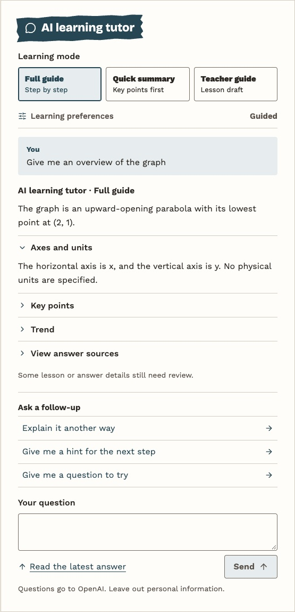

# AccessSTEM AI

An AI tutor that helps blind and low-vision high-school learners explore function graphs through text, guided questions, and adjustable explanations.

[繁體中文](README.zh-TW.md) · [Live demo](https://accessstem-ai.vercel.app/) · [Public chat history](https://accessstem-ai.vercel.app/waicy/chat-history) · [WAICY presentation (PDF)](docs/LLM_High_AccessSTEMAI.anonymized.pdf)

## Overview

Graph lessons often present meaning through position, slope, or shape. AccessSTEM AI describes those relationships in words and lets learners ask about the details they need. Built for the WAICY 2026 AI Large Language Model Track, the prototype covers three sample linear and quadratic function graphs. The samples are awaiting teacher review.

## Try the demo

1. Open the [workspace](https://accessstem-ai.vercel.app/) and select a sample graph or paste a text problem with its formula, coordinates, or scale.
2. Choose **Full guide**, **Quick summary**, or **Teacher guide**. In **Learning preferences**, set the solution style to **Hints only** to get one step before seeing the result.
3. Ask a question about the graph. For example, ask how to find the vertex, or have the tutor draft one question you can read to students.

The workspace opens in English. Choose **繁體中文** in the header or open the [Traditional Chinese workspace](https://accessstem-ai.vercel.app/?lang=zh-Hant).



## Features

| Mode or tool | What it provides |
| --- | --- |
| **Text-based graph lessons** | A readable formula, axis labels and units when available, a coordinate table, and a description of trends. |
| **Full guide** | A walkthrough of axes, key points, and trends. The first detail opens automatically at the default depth. |
| **Quick summary** | The main takeaway and one supporting section at brief depth. Follow-ups can request more detail in the same conversation. |
| **Teacher guide** | A copyable draft with a classroom explanation, a common misconception, and three guiding questions. A request for one classroom question gets a student-facing question in the summary. |
| **Solution style** | Hints only gives a first step. Guided walks through the reasoning. Full solution shows the result and checkable steps. |
| **Evidence and uncertainty** | Replies distinguish supplied facts, mathematical deductions, and missing information. When a unit or scale is missing, the tutor can ask for the evidence needed to answer. |

## How it works

The Next.js workspace in `web/` pairs sample graph facts or a text problem with the selected mode and recent turns. The server validates the request, calls the OpenAI Responses API, and validates the structured reply before rendering it. Conversation state lives in the current page. Use fictional details in chat because questions are sent to OpenAI. [Architecture](docs/architecture.md) · [API contract](docs/api-and-data-contracts.md) · [Data and privacy](docs/security-and-privacy.md)

## Quick start

Use Node.js 24 LTS and pnpm 10.33.0. Run the following commands from the repository root.

```sh
cd web
pnpm install --frozen-lockfile
cp .env.example .env.local
pnpm dev
```

Open [http://localhost:3000](http://localhost:3000/). The lessons work on their own. To enable chat, set `OPENAI_API_KEY` in `web/.env.local` and restart. The default model is `gpt-6.1-terra` with low reasoning effort. [Web setup and verification](web/README.md) · [Vercel deployment](docs/deployment.md)

## Verification and limitations

- The [V5 test report](docs/waicy-submission/evaluation/v5-test-report.md) covers matched explanation depth, hint pacing, and follow-ups about missing units. The [evaluation protocol](docs/evaluation-plan.md) and [iteration log](docs/waicy-iteration-log.md) describe the cases, earlier versions, and retests.
- The [public transcript](https://accessstem-ai.vercel.app/waicy/chat-history) contains nine scripted questions entered by an AI agent and nine live tutor replies. Classroom validation, teacher review, and VoiceOver acceptance remain open.
- The current workspace uses structured samples and text. Image upload, speech features, learner accounts, and saved conversations remain outside this prototype.

## Documentation

| Resource | Contents |
| --- | --- |
| [Project overview](docs/project-overview.md) · [Implementation plan](docs/implementation-plan.md) | Scope, requirements, and engineering status |
| [Agent design](docs/agent-design.md) · [Accessibility design](docs/ux-accessibility.md) | Teaching modes, prompt behavior, and interaction design |
| [WAICY materials](docs/waicy-submission/) · [Competition and rubric](docs/competition.md) | Presentation source, research, and submission resources |
| [Slide-maker handoff](docs/waicy-submission/slide-maker-handoff.md) · [Screenshot index](docs/assets/waicy-screenshots/WAICY-screenshot-index.md) · [Demo guide](docs/demo-and-submission.md) | Public links, examples, and walkthrough |
