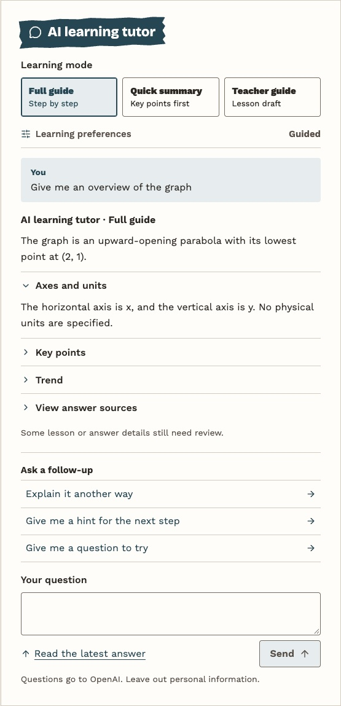

# AccessSTEM AI

為全盲與低視力高中生設計的 AI 函數圖表助教，以文字、引導題及可調整的解說，協助學生理解圖表。

[English](README.md) · [公開展示](https://accessstem-ai.vercel.app/?lang=zh-Hant) · [公開對話紀錄](https://accessstem-ai.vercel.app/waicy/chat-history) · [WAICY 簡報（PDF）](docs/LLM_High_AccessSTEMAI.anonymized.pdf)

## 專案概覽

函數圖表常以位置、斜率或形狀傳達關係。AccessSTEM AI 把這些關係寫成文字，讓學生依自己的步調閱讀和追問。本專案是 WAICY 2026 AI 大語言模型賽道的參賽原型，包含三份一次與二次函數範例，教材仍待教師核對。

## 試用展示

1. 開啟[學習工作區](https://accessstem-ai.vercel.app/?lang=zh-Hant)，選擇內建圖表，或貼上包含公式、座標或刻度的文字題目。
2. 選擇**完整導讀**、**重點短述**或**教師引導**。想先試著自己解題，可以在調整學習偏好中選擇**只給提示**。
3. 問一個與圖表相關的問題，例如如何找頂點，或請助教寫一道可以讀給學生聽的引導題。

工作區預設英文，可從頁首切換至繁體中文。



## 核心功能

| 模式或工具 | 內容 |
| --- | --- |
| **文字圖表教材** | 顯示可朗讀的公式、軸與單位（已提供時）、座標表及變化趨勢。 |
| **完整導讀** | 依序說明座標軸、關鍵點與趨勢。預設解說深度會展開第一層細節。 |
| **重點短述** | 在簡短深度下，先給重點及一段輔助說明。可以在同一段對話中要求展開。 |
| **教師引導** | 提供可複製的課堂草稿、常見誤解與三道引導題。若只要一題，會在摘要直接提供可問學生的題目。 |
| **解題方式** | 只給提示提供第一步，循序引導逐步說明，完整解答給出結果及可檢查的步驟。 |
| **資料依據與缺漏** | 說明已知資料、數學推導和待確認資訊。缺少刻度或單位時，助教可以追問作答所需的依據。 |

## 運作方式

`web/` 的 Next.js 工作區會把範例圖表或文字題目、選定的學習模式及近期對話送給伺服器。伺服器驗證請求，呼叫 OpenAI Responses API，再驗證回覆結構後顯示。對話狀態保留在目前分頁。問題會傳送至 OpenAI，請使用虛構資訊。 [系統架構](docs/architecture.md) · [API 契約](docs/api-and-data-contracts.md) · [資料安全與隱私](docs/security-and-privacy.md)

## 快速開始

使用 Node.js 24 LTS 與 pnpm 10.33.0。從 repository 根目錄執行以下指令。

```sh
cd web
pnpm install --frozen-lockfile
cp .env.example .env.local
pnpm dev
```

開啟 [http://localhost:3000](http://localhost:3000/)。教材可獨立使用。要啟用聊天，在 `web/.env.local` 設定 `OPENAI_API_KEY` 後重啟。預設模型是 `gpt-6.1-terra`，推理強度為 low。 [Web 設定與驗證](web/README.md) · [Vercel 部署](docs/deployment.md)

## 驗證與限制

- [V5 測試報告](docs/waicy-submission/evaluation/v5-test-report.md) 涵蓋相同題目在不同解說深度的對照、提示節奏及缺少單位時的追問。其他案例、歷史版本與重測見[評估計畫](docs/evaluation-plan.md)和[迭代紀錄](docs/waicy-iteration-log.md)。
- [公開對話紀錄](https://accessstem-ai.vercel.app/waicy/chat-history) 包含由 AI Agent 依腳本輸入的九題與正式站的九則回覆。課堂驗證、教師審查及 VoiceOver 驗收仍待完成。
- 目前支援結構化範例與文字題目。圖片上傳、語音功能、學習者帳號及對話保存仍在原型範圍之外。

## 文件索引

| 資源 | 內容 |
| --- | --- |
| [專案概覽](docs/project-overview.md) · [實作計畫](docs/implementation-plan.md) | 產品範圍、需求與工程進度 |
| [助教設計](docs/agent-design.md) · [無障礙設計](docs/ux-accessibility.md) | 教學模式、提示詞和操作方式 |
| [WAICY 資料](docs/waicy-submission/) · [競賽與評分規則](docs/competition.md) | 簡報原始檔、研究與送件資源 |
| [簡報交接](docs/waicy-submission/slide-maker-handoff.md) · [截圖索引](docs/assets/waicy-screenshots/WAICY-screenshot-index.md) · [展示指南](docs/demo-and-submission.md) | 公開連結、操作和實測範例 |
