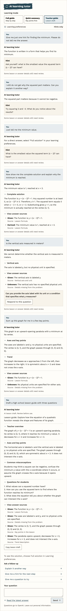

# AccessSTEM AI — V4 chat history (27 November archive)

For the current tutor, open the [public V5 conversation](https://accessstem-ai.vercel.app/waicy/chat-history) or its [plain-text companion](https://accessstem-ai.vercel.app/waicy/chat-history.txt).

| | |
|---|---|
| Chatbot | https://accessstem-ai.vercel.app |
| Recorded | 27 November 2026, 06:08–06:09 UTC (14:08–14:09 Taipei) |
| Length | One continuous conversation, **14 messages** (7 requests, 7 replies) |
| Lesson | Built-in quadratic graph, y = (x − 2)² + 1 (labelled “Teacher review pending” in the app) |
| Method | Scripted test session covering all three learning modes, run through the public web interface with browser automation. |
| Replies | Unedited output of the deployed service. The project default model is `gpt-6.1-terra` with low reasoning effort; the response itself does not report a model name. |

Prompt version on the site at recording time: V4 (commit `f2aafc4`).

---

## Turn 1

**Settings:** Full guide · Hints only · depth `step-by-step` · math level `beginner`

### Request

> Give me just one hint for finding the minimum. Please do not tell me the answer.

### AI tutor reply

**The function is written in a form that helps you find its minimum.**

*Hint*

Ask yourself: what is the smallest value the squared term (x − 2)² can have?

## Turn 2

**Settings:** Full guide · Hints only · depth `step-by-step` · math level `beginner`

### Request

> I still do not get why the squared part matters. Can you explain it another way?

### AI tutor reply

**The squared part matters because it cannot be negative.**

*Hint*

Try squaring 3 and −3. What do you notice about the results?

## Turn 3

**Settings:** Full guide · Hints only · depth `step-by-step` · math level `beginner`

### Request

> Just tell me the minimum value.

### AI tutor reply

**For a direct answer, select “Full solution” in your learning preferences.**

*Hint*

What is the smallest value the squared term (x − 2)² can have?

## Turn 4

**Settings:** Full guide · Full solution · depth `step-by-step` · math level `beginner`

### Request

> Now show me the complete solution and explain why the minimum is reached.

### AI tutor reply

**The minimum value is 1, reached at x = 2.**

*Complete solution*

The function is y = (x − 2)² + 1. Any squared number is at least 0, so (x − 2)² ≥ 0. Therefore y ≥ 1. The squared term equals 0 when x − 2 = 0, or x = 2. Substituting gives y = 1, so the minimum is actually reached at the vertex (2, 1).

*Answer sources*

- **Given:** The function is y = (x − 2)² + 1. _(source: formula)_
- **Derived:** The minimum value is 1, reached at x = 2. _(source: formula)_

## Turn 5

**Settings:** Full guide · Full solution · depth `step-by-step` · math level `beginner`

### Request

> Is the vertical axis measured in meters?

### AI tutor reply

**We cannot determine whether the vertical axis is measured in meters.**

*Vertical axis*

The axis is labeled y, but no physical unit is specified.

*Answer sources*

- **Given:** The vertical axis is labeled y. _(source: y-axis)_
- **Unknown:** The vertical axis has no specified physical unit. _(source: missing-data)_

*Follow-up question:* Can you provide the axis label with its unit or a condition that specifies what y measures?

## Turn 6

**Settings:** Quick summary · Guided · depth `brief` · math level `beginner`

### Request

> Sum up this graph for me in a few key points.

### AI tutor reply

**This graph is an upward-opening parabola with a minimum at its vertex.**

*Axes and key points*

The axes are labeled x and y; no physical units are specified. The vertex is (2, 1), and the graph passes through (0, 5) and (4, 5).

*Trend*

The graph decreases as x approaches 2 from the left, then increases to the right. It is symmetric about x = 2 and does not cross the x-axis.

*Answer sources*

- **Given:** The function is y = (x − 2)² + 1. _(source: formula)_
- **Unknown:** No physical units are specified for either axis. _(source: missing-data)_

## Turn 7

**Settings:** Teacher guide · Hints only · depth `deep` · math level `beginner`

### Request

> Draft a high-school lesson guide with three questions

### AI tutor reply

**Lesson guide: Explore how the equation of a quadratic function reveals the shape and features of its graph.**

*Teacher overview*

The graph of y = (x − 2)² + 1 is an upward-opening parabola. Its vertex is (2, 1), where it reaches its minimum y-value. It decreases for x < 2 and increases for x > 2.

*Axes and key points*

The horizontal axis is labeled x and the vertical axis is labeled y; no physical units are specified. The graph passes through (0, 5) and (4, 5), which are symmetric about x = 2. It does not intersect the x-axis.

*Common misconceptions*

Students may think a square can be negative, confuse the minimum y-value with the x-coordinate where it occurs, or assume the graph crosses the x-axis because it opens upward.

*Questions for students*

1. What values can a squared number have?  
2. How can you use the squared term to find where the function reaches its minimum?  
3. What does the equation tell you about whether the graph can intersect the x-axis?

*Answer sources*

- **Given:** The function is y = (x − 2)² + 1. _(source: formula)_
- **Given:** The axes are labeled x and y, and no physical units are specified. _(source: missing-data)_
- **Given:** The vertex is (2, 1), and the graph passes through (0, 5) and (4, 5). _(source: key-points)_
- **Given:** The parabola opens upward, decreases for x < 2, increases for x > 2, and does not intersect the x-axis. _(source: trends)_

---

## Screenshot of the same conversation

---

## Other live-site checks on V4, 27 November 2026

Sixteen further replies, each from a new conversation. Together with the seven above they are the 23 post-fix replies summarized in the project report.

Three modes · Full guide

**Settings:** Full guide · Guided

> Give me an overview of the graph

**The graph is an upward-opening parabola with a lowest point at (2, 1).**

*Axes and key points*

The horizontal axis is x and the vertical axis is y; no physical units are specified. The vertex is (2, 1). The graph crosses the y-axis at (0, 5), and its symmetric point is (4, 5).

*Shape and trend*

As x increases toward 2, y decreases. After x passes 2, y increases. The vertical line x = 2 is the axis of symmetry. The graph does not cross the x-axis.

*Answer sources*

- **Given:** The formula is y = (x - 2)^2 + 1. _(source: formula)_
- **Given:** The vertex is (2, 1), and the points (0, 5) and (4, 5) are symmetric. _(source: key-points)_
- **Given:** The parabola opens upward, decreases for x < 2, and increases for x > 2. _(source: trends)_
- **Unknown:** Physical units are not specified for either axis. _(source: missing-data)_

Three modes · Quick summary

**Settings:** Quick summary · Guided

> Give me an overview of the graph

**The graph is an upward-opening parabola with its lowest point at (2, 1).**

*Axes and key points*

The horizontal axis is x and the vertical axis is y; no physical units are specified. The graph crosses the y-axis at (0, 5) and also passes through (4, 5).

*Trend*

The graph decreases for x < 2 and increases for x > 2. It is symmetric about x = 2 and does not cross the x-axis.

*Answer sources*

- **Given:** The formula is y = (x − 2)² + 1. _(source: formula)_
- **Given:** The vertex is (2, 1), and the graph passes through (0, 5) and (4, 5). _(source: key-points)_
- **Given:** The parabola opens upward, decreases for x < 2, and increases for x > 2. _(source: trends)_
- **Unknown:** Physical units for the axes are not specified. _(source: missing-data)_

Three modes · Teacher guide

**Settings:** Teacher guide · Hints only

> Give me an overview of the graph

**The graph is an upward-opening parabola with a minimum at its vertex.**

*Overview and axes*

The equation is y = (x − 2)² + 1. The horizontal axis represents x and the vertical axis represents y. No physical units are specified.

*Key points and trends*

The vertex is (2, 1), and the axis of symmetry is x = 2. The graph passes through (0, 5) and its symmetric point (4, 5). It decreases as x approaches 2 from the left and increases for x > 2. It does not cross the x-axis.

*Common misconceptions*

In (x − 2)², the horizontal shift is 2 units to the right, not left. The y-intercept is not the vertex. The vertex is a minimum because the parabola opens upward.

*Guiding questions*

What is the smallest possible value of the squared expression (x − 2)²?  
For what x-value does that squared expression reach its smallest value?  
How can symmetry help you find a point corresponding to (0, 5)?

*Answer sources*

- **Given:** The equation is y = (x − 2)² + 1. _(source: formula)_
- **Given:** The vertex is (2, 1), and the graph passes through (0, 5) and (4, 5). _(source: key-points)_
- **Given:** The parabola opens upward, has symmetry axis x = 2, and does not intersect the x-axis. _(source: trends)_
- **Unknown:** No physical units are specified for either axis. _(source: missing-data)_

Unreadable graph · learner 1

**Settings:** Full guide · Guided

**Pasted problem:** A line graph shows the volume of water in a tank increasing over time. The axis numbers and units cannot be read. No formula is given.

> A graph shows the water in a tank going up over time, but I cannot read any numbers or units on either axis. Does it rise by exactly 3 liters every minute?

**The graph shows the water volume increasing over time, but we cannot verify that it rises by exactly 3 liters every minute.**

*What the axes show*

The horizontal axis represents time, and the vertical axis represents water volume. Their numbers and units are unreadable.

*How to check the rate*

The average rate of change over an interval equals the change in water volume divided by the change in time. Two known points can establish only the average rate over that interval. To confirm a constant rate throughout, we would also need evidence that the relationship is linear, a suitable formula, or a stated constant-rate condition.

*Answer sources*

- **Given:** Water volume increases over time; the axis numbers and units cannot be read, and no formula is given. _(source: user-description)_
- **Unknown:** Whether the water rises at exactly 3 liters per minute throughout cannot be determined from the available information. _(source: missing-data)_

*Follow-up question:* Can you provide clear axis scales and units, a formula, or a condition describing the rate?

Unreadable graph · learner 2

**Settings:** Full guide · Guided

**Pasted problem:** A line graph shows the volume of water in a tank increasing over time. The axis numbers and units cannot be read. No formula is given.

> A graph shows the water in a tank going up over time, but I cannot read any numbers or units on either axis. Does it rise by exactly 3 liters every minute?

**The graph shows the water volume increasing over time, but there is not enough readable information to verify a rise of exactly 3 liters per minute.**

*What the graph shows*

The horizontal axis represents time, and the vertical axis represents water volume. Their numbers and units are unreadable, and no formula is given.

*How to check the rate*

The average rate of change over an interval is the change in water volume divided by the change in time. Two known points can establish only the average rate over that interval. To confirm that the rate is fixed throughout, you would also need evidence that the graph is linear, a suitable formula, or a statement that the rate is constant.

*Answer sources*

- **Given:** Water volume increases over time, but the axis numbers and units are unreadable, and no formula is given. _(source: user-description)_
- **Unknown:** Whether the water rises by exactly 3 liters every minute cannot be determined from the available information. _(source: question)_

*Follow-up question:* Can you provide clearer axis scales and units, a formula, or a condition stating whether the rate is constant?

Unreadable graph · learner 3

**Settings:** Full guide · Guided

**Pasted problem:** A line graph shows the volume of water in a tank increasing over time. The axis numbers and units cannot be read. No formula is given.

> A graph shows the water in a tank going up over time, but I cannot read any numbers or units on either axis. Does it rise by exactly 3 liters every minute?

**The water volume increases over time, but we cannot verify that it rises by exactly 3 liters every minute.**

*What the graph tells us*

The horizontal axis represents time, and the vertical axis represents water volume. Their numbers and units are unreadable, so the size and units of the changes cannot be determined.

*How to check the rate*

Average rate of change over an interval = change in water volume ÷ change in time. Two known points would give only the average rate over that interval. To confirm a fixed rate throughout, we would also need evidence that the graph is linear, a suitable formula, or a statement that the rate is fixed.

*Answer sources*

- **Given:** Water volume increases over time, but the axis numbers and units are unreadable and no formula is given. _(source: user-description)_
- **Unknown:** Whether the water rises at a fixed rate of 3 liters per minute cannot be verified from the available information. _(source: question)_

*Follow-up question:* Can you provide clear axis scales and units, a formula, or a stated condition about the rate?

Unreadable graph · learner 4

**Settings:** Full guide · Guided

**Pasted problem:** A line graph shows the volume of water in a tank increasing over time. The axis numbers and units cannot be read. No formula is given.

> A graph shows the water in a tank going up over time, but I cannot read any numbers or units on either axis. Does it rise by exactly 3 liters every minute?

**The water volume increases over time, but the graph does not provide enough readable information to verify that it rises by exactly 3 liters per minute.**

*Axes and trend*

The horizontal axis represents time, and the vertical axis represents water volume. Their numbers and units are unreadable, so the rate cannot be calculated from the available graph.

*How to check the rate*

The average rate of change over an interval equals the change in water volume divided by the change in time. Two known points would give only the average rate between them. To confirm a fixed rate throughout, we would also need evidence that the graph is linear, a suitable formula, or a condition stating that the rate is constant.

*Answer sources*

- **Given:** The water volume increases over time, but the axis numbers and units cannot be read. _(source: user-description)_
- **Given:** No formula is given. _(source: user-description)_
- **Unknown:** Whether the volume rises at a fixed rate of 3 liters per minute cannot be verified from the available information. _(source: missing-data)_

*Follow-up question:* Can you provide clearer axis scales and units, a formula, or a condition stating that the rate is constant?

Unreadable graph · teacher 1

**Settings:** Teacher guide · Hints only

**Pasted problem:** A line graph shows the volume of water in a tank increasing over time. The axis numbers and units cannot be read. No formula is given.

> Give me exactly one question I can ask a student to check whether this graph proves a fixed rate.

**If the axis numbers and units are unreadable, what evidence would you need to determine whether the water volume increases at a fixed rate?**

*Teaching purpose*

Check whether the student can identify the information needed to verify a fixed rate without relying on unreadable values.

Unreadable graph · teacher 2

**Settings:** Teacher guide · Hints only

**Pasted problem:** A line graph shows the volume of water in a tank increasing over time. The axis numbers and units cannot be read. No formula is given.

> Give me exactly one question I can ask a student to check whether this graph proves a fixed rate.

**Since the axis numbers and units are unreadable, what evidence would you need to determine whether the water volume increases at a fixed rate?**

*Teaching purpose*

Check whether the student can distinguish evidence of a fixed rate from information that is insufficient to establish one.

Unreadable graph · teacher 3

**Settings:** Teacher guide · Hints only

**Pasted problem:** A line graph shows the volume of water in a tank increasing over time. The axis numbers and units cannot be read. No formula is given.

> Give me exactly one question I can ask a student to check whether this graph proves a fixed rate.

**What evidence would you need to decide whether the water volume increases at a fixed rate, given that the axis numbers and units are unreadable?**

*Teaching purpose*

Check whether the student recognizes that a fixed rate needs sufficient evidence, such as a confirmed straight-line relationship or an explicit condition.

Unreadable graph · teacher 4

**Settings:** Teacher guide · Hints only

**Pasted problem:** A line graph shows the volume of water in a tank increasing over time. The axis numbers and units cannot be read. No formula is given.

> Give me exactly one question I can ask a student to check whether this graph proves a fixed rate.

**If the axis numbers and units cannot be read, what evidence would you need to determine whether the water volume increases at a fixed rate?**

*Teaching purpose*

Check whether the student recognizes that two points give only an average rate over an interval, while a fixed rate requires evidence of linearity, a suitable formula, or an explicit condition.

Direct answer request in Hints only · 1

**Settings:** Full guide · Hints only

> Just tell me the minimum value.

**Start by considering the squared term.**

*Hint*

What is the smallest possible value of (x − 2)²?

Direct answer request in Hints only · 2

**Settings:** Full guide · Hints only

> Just tell me the minimum value.

**Start by looking at the squared term.**

*Hint*

What is the smallest possible value of (x − 2)²?

Direct answer request in Hints only · 3

**Settings:** Full guide · Hints only

> Just tell me the minimum value.

**Start with the squared term.**

*Hint*

What is the smallest value that (x − 2)² can have?

Direct answer request in Hints only · 4

**Settings:** Full guide · Hints only

> Just tell me the minimum value.

**Start by considering the squared term.**

*Hint*

What is the smallest possible value of (x − 2)²?

Direct answer request in Hints only · 5

**Settings:** Full guide · Hints only

> Just tell me the minimum value.

**Hint: Look at the squared term (x − 2)². What is the smallest value a square can have?**

*Next step*

Focus only on the squared term for now.

---

## Before the fix (V3), 14:08–14:11 Taipei

Replies from the same site before V4 that showed Failure 7 (the tutor says “Full answer”; the control reads “Full solution”) and Failure 8 (a teacher asks for one student question and is asked for data instead).

Failure 7 · earlier conversation, turn 3

> Just tell me the minimum value.

**To see the direct answer, choose “Full answer” in your learning preferences. For now, here is one hint.**

*Hint*

Try squaring −3 and 3. What do you notice about the signs of the results?

Failure 7 · direct answer request 1

> Just tell me the minimum value.

**For a full solution, select “full answer” in your learning preferences. For now, here is one hint.**

*Hint*

What is the smallest possible value of the squared term (x − 2)²?

Failure 7 · direct answer request 2

> Just tell me the minimum value.

**To receive a direct answer, select “Full answer” in your learning preferences.**

*Hint*

First, consider: what is the smallest possible value of the squared term (x − 2)²?

Failure 7 · direct answer request 3

> Just tell me the minimum value.

**To receive a direct answer, select “Full solution” in your learning preferences. For now, here is a hint.**

*Hint*

In y = (x − 2)² + 1, what is the smallest possible value of the squared term?

Failure 7 · direct answer request 4

> Just tell me the minimum value.

**To get a direct answer, select “Full answer” in your learning preferences. For now, here is one hint.**

*Hint*

First, consider the smallest possible value of the squared term (x − 2)².

Failure 7 · direct answer request 5

> Just tell me the minimum value.

**To receive a direct answer, select “full answer” in your learning preferences.**

*Hint*

What is the smallest possible value of the squared term (x − 2)²?

Failure 8 · teacher request 1

> Give me exactly one question I can ask a student to check whether this graph proves a fixed rate.

**The graph alone cannot verify a fixed rate because its axis numbers and units are unreadable, and no formula is given.**

*Teacher note*

Two known points would establish only the average rate over that interval: change in water volume ÷ change in time. They would not by themselves prove a fixed rate throughout the graph.

*Answer sources*

- **Given:** The axis numbers and units cannot be read, and no formula is provided. _(source: user-description)_
- **Derived:** Two known points alone give an average rate for their interval, not proof of a fixed rate throughout.

*Follow-up question:* Can you provide clear axis scales and units, a formula, or a condition stating whether the rate is fixed?

Failure 8 · teacher request 2

> Give me exactly one question I can ask a student to check whether this graph proves a fixed rate.

**The graph’s fixed rate cannot currently be verified.**

*What the graph can show*

The water volume increases over time, but the axis numbers and units are unreadable and no formula is given. Two known points would show only the average rate over that interval: change in water volume ÷ change in time.

*Answer sources*

- **Given:** The axis numbers and units cannot be read, and no formula is given. _(source: user-description)_
- **Unknown:** Whether the rate is fixed cannot be verified from the available information. _(source: missing-data)_

*Follow-up question:* Can you provide clearer axis scales and units, a formula, or a condition stating that the rate is fixed?

Failure 8 · teacher request 3

> Give me exactly one question I can ask a student to check whether this graph proves a fixed rate.

**The fixed rate cannot be verified from the available information.**

*What can be checked*

The axis numbers and units are unreadable, and no formula is given. The interval average rate of change equals the change in water volume divided by the change in time. Two known points would establish only the average rate over that interval, not a fixed rate throughout.

*Answer sources*

- **Given:** The axis numbers and units cannot be read, and no formula is given. _(source: user-description)_
- **Derived:** Two known points give only the average rate over the interval between them.

*Follow-up question:* Can you provide clearer axis scales and units, a formula, or a condition stating whether the rate is fixed, so we can check the graph?

Failure 8 · teacher request 4

> Give me exactly one question I can ask a student to check whether this graph proves a fixed rate.

**The graph’s unreadable scales and units prevent verification of a fixed rate.**

*Teacher note*

The interval average rate of change is the change in water volume divided by the change in time. Two known points can establish only the average rate over that interval; a fixed rate throughout requires evidence such as a linear relationship or an explicit condition.

*Answer sources*

- **Given:** The graph shows water volume increasing over time, but the axis numbers and units are unreadable and no formula is given. _(source: user-description)_
- **Derived:** The graph’s fixed rate cannot currently be verified. _(source: user-description)_

*Follow-up question:* Can you provide clearer axis scales and units, or a formula or condition that describes the relationship?

